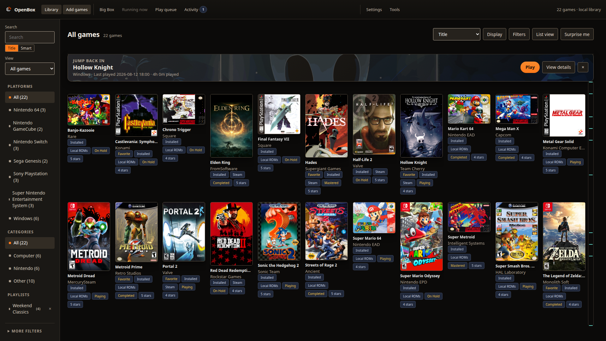
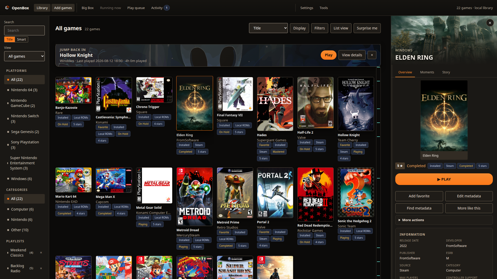
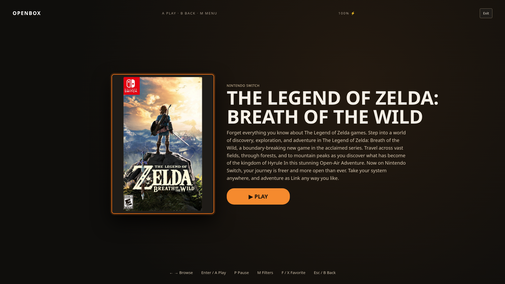
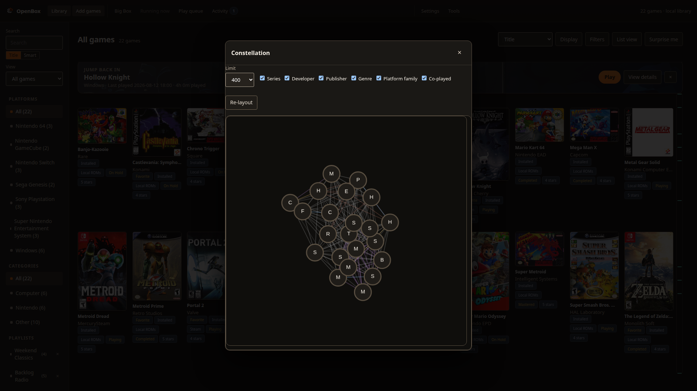

<p align="center">
  
</p>

<h1 align="center">
  <picture>
    <source media="(prefers-color-scheme: dark)" srcset="assets/openboxgl-title-dark.png">
    <source media="(prefers-color-scheme: light)" srcset="assets/openboxgl-title-light.png">
    
  </picture>
</h1>

<p align="center">
  Local-first game library and launcher for Linux, Windows, and macOS — powered by a standalone native Rust server
</p>

<p align="center">
  <a href="LICENSE"></a>
  <a href="Cargo.toml"></a>
  <a href="https://github.com/vindeckyy/OpenBoxGL/releases/tag/v3.0.0"></a>
  <a href="https://github.com/vindeckyy/OpenBoxGL/actions/workflows/ci.yml"></a>
  <a href="https://github.com/vindeckyy/OpenBoxGL/releases/latest"></a>
  <br>
  <a href="https://github.com/vindeckyy/OpenBoxGL/releases/latest"><strong>Latest stable: v3.0.0</strong></a>
</p>

<p align="center">
  <a href="https://www.buymeacoffee.com/haydenopenbox" target="_blank" rel="noopener noreferrer">
    
  </a>
</p>

<p align="center">
  <a href="#quick-start">Quick Start</a> |
  <a href="#overview">Overview</a> |
  <a href="#whats-new-in-openbox-30-the-rust-y-box">What's New in 3.0</a> |
  <a href="#rust-server-and-native-desktop-host-architecture">Rust &amp; Native Host</a> |
  <a href="#features">Features</a> |
  <a href="#screenshots">Screenshots</a> |
  <a href="#installation">Installation</a> |
  <a href="#documentation">Documentation</a> |
  <a href="#rest-api">REST API</a> |
  <a href="#faq">FAQ</a> |
  <a href="#development">Development</a> |
  <a href="#legal">Legal</a>
</p>

<p align="center">
  <a href="#screenshots">
    
  </a>
  <br>
  <sub>One local-first library for Steam, ROMs, and emulators — powered by native Rust. Click for more screenshots.</sub>
</p>

---

## Quick Start

1. **Install (no Python required to run).**
   - **Linux:** Grab the [latest AppImage](https://github.com/vindeckyy/OpenBoxGL/releases/latest) (`x86_64` or `aarch64`), run the signed `install.sh` installer, or install `OpenBox-x86_64.flatpak`.
   - **Windows:** Download `OpenBox-x86_64-windows.zip` (or `OpenBox-arm64-windows.zip`) from the [latest release](https://github.com/vindeckyy/OpenBoxGL/releases/latest), extract it, and launch `OpenBox\openbox.cmd` directly — no Python needed. For Start Menu integration, `openbox://` links, and `PATH`, run `OpenBox\scripts\install.ps1` (signature verification in `install.ps1` uses Python 3.11+).
   - **macOS:** Download and run `install-macos.sh` from the same release to verify `OpenBox-macos.zip` and install the universal `OpenBox.app` (`arm64` + `x86_64`, zero bundled Python) into `~/Applications`. The bundle is ad-hoc signed, so first launch asks you to allow it in **System Settings > Privacy & Security > Open Anyway**.
   - **From source:** Build the Rust backend with `cargo build --release -p openbox-cli` and run `./openbox.sh` on Linux/macOS (`.\openbox.cmd` on Windows), or run the legacy Python fallback with `OPENBOX_BACKEND=python ./openbox.sh` / `python3 web_app.py` (Python 3.11+).
2. **Open the UI.** `openbox` (or `openbox-native`) opens the native desktop window (WebKitGTK on Linux, WebView2 on Windows, WKWebView on macOS), which launches and supervises the compiled Rust `openbox-server` directly. `openbox --web` skips the native window and runs `openbox-server` directly on loopback (`127.0.0.1`), printing the tokenless URL to stdout while writing `0600` `server.port` and `server.token` files in your data directory — open `http://127.0.0.1:PORT/?token=$(cat ~/.local/share/openbox-game-launcher/server.token)` in any browser. Steam Deck / gamescope kiosk (Linux only): `openbox --web --game-mode`. Treat token-bearing URLs as secrets; prefer the `X-OpenBox-Token` header for scripts and never paste or share the URL.
3. **Import games.** Open **Add games** (or Guided Setup) to import a folder of ROMs or launch scripts, or scan installed Steam and storefront libraries.
4. **Press PLAY.** Sessions, play time, saves, and history are tracked automatically.

For ROMs, emulators, Big Box, RetroAchievements, and everything else, see [Getting started](https://openboxgl.github.io/getting-started/) and [Installation](https://openboxgl.github.io/install/).

---

## Overview

OpenBox Game Launcher is an open-source, local-first game library manager and launcher for Linux, Windows, and macOS. It brings Steam, Heroic (Epic/GOG/Amazon), Lutris, Faugus, Gameyfin, ROM folders, ScummVM, RPCS3, Vita3K, Eden Switch, arcade (MAME/FinalBurn), and local executables into one searchable catalog backed by a standalone native Rust server (`openbox-server`). On Windows it also imports installed GOG, EA app, and Ubisoft Connect games natively. OpenBox scales formally to **50,000 games** on a human-readable `library.json` with zero accounts, zero vendor cloud lock-in, and zero telemetry.

OpenBox Game Launcher is unrelated to [Openbox](https://openbox.org/), the open-source Linux window manager. The projects have different maintainers, codebases, and purposes.

OpenBox provides one UI over two entry points, both served by the compiled native Rust `openbox-server` binary:

| Entry point | Use when |
| --- | --- |
| `openbox` or `openbox-native` | Default desktop use; a thin native window (WebKitGTK on Linux, WebView2 on Windows, WKWebView on macOS) supervises `openbox-server` directly |
| `openbox --web` or `openbox-server` | Headless loopback server for browser tabs, REST API automation, Steam Game Mode (`--game-mode`, Linux only), and development (`OPENBOX_BACKEND=python` or `python3 web_app.py` remains available on source checkouts) |

Library data is stored locally at `~/.local/share/openbox-game-launcher/library.json` (`%LOCALAPPDATA%\openbox-game-launcher\library.json` on Windows, `~/Library/Application Support/openbox-game-launcher/library.json` on macOS). Set `OPENBOX_DATA_DIR` before launch to use a different data directory.

> **Independence notice:** OpenBox Game Launcher is an independent open-source project. It is not affiliated with LaunchBox, Unbroken Software, LLC, or the Openbox window manager project. LaunchBox and Big Box are trademarks of Unbroken Software, LLC. See [DISCLAIMER.md](docs/DISCLAIMER.md).

---

## What's New in OpenBox 3.0 ("The Rust-y Box")

> **Zero-friction upgrade from OpenBox 2.0 / 2.1:** Install 3.0 over your existing copy and open it. Your `library.json` (schema 7), covers, saves, settings, themes, and playlists load untouched with **zero migration and zero re-scraping**, and OpenBox 2.1 can still open a 3.0 library. Coming from 1.x? See [docs/upgrade-3.0.md](docs/upgrade-3.0.md) and the full [3.0.0 Release Notes](docs/RELEASE_NOTES.md).

### Native Rust Backend & 50,000-Game Scale

OpenBox 3.0 replaces the Python backend with a standalone native Rust server (`openbox-server`, [ADR 0115](docs/adr/0115-rust-backend-migration.md)) spanning **15 workspace crates** (`crates/`), **170 migrated backend modules**, and all **417 HTTP endpoints** (**413** public `/api/v2/*` routes + **4** `/api/host/*` native-window routes) with zero bundled Python runtime:

- **Formal scale graduates to 50,000 games** ([ADR 0116](docs/adr/0116-50k-scale-graduation.md)): The earlier CPython 50,000-game graduation run missed the 1,500 MB RSS budget (`2,163.3 MB` on Apple M4), and even the same-machine Linux Python 3.0 run below uses `1,281.9 MB`. On Rust, the full 50,000-game benchmark finishes at **468.8 MB RSS** (**31.3%** of the budget, **2.73x less RAM**) while keeping canonical `library.json` human-readable and 100% compatible with 2.1.
- **Smaller self-contained releases:** Dropping embedded CPython shrinks the universal macOS download by **59.1%** (**17.4 MiB** down from 42.5 MiB), trims Linux AppImages to **9.7 MiB** (`x86_64`) and **9.0 MiB** (`aarch64`), keeps the Linux Flatpak at **7.1 MiB**, and bundles standalone `openbox-server.exe` inside Windows portable zips (**14.6 MiB** x86_64 / **13.8 MiB** ARM64).

Measured head-to-head on Linux x86_64 (AMD Ryzen 5 4600H, 16 GiB RAM, `scripts/perf_bench.py --sizes 10000,20000,50000 --runs 3 --memory`):

| 50,000-Game Metric (p95) | Python 3.0 (`web_app.py`) | Rust 3.0 (`openbox-server`) | Upgrade |
| --- | ---: | ---: | --- |
| Server RSS after benchmark | 1,281.9 MB | **468.8 MB** | **2.73x less RAM** |
| Cover media serving (`/api/v2/media`) | 2,346.9 ms | **0.4 ms** | **5,867x faster** |
| Explorer facets (`/api/v2/explorer/facets`) | 2,998.0 ms | **21.1 ms** | **142.1x faster** |
| Live delta search (`/api/v2/library/delta`) | 41.3 ms | **0.5 ms** | **82.6x faster** |
| Insights milestones (`/api/v2/insights/milestones`) | 2,599.9 ms | **157.5 ms** | **16.5x faster** |
| Smart Picker (`POST /api/v2/library/pick`) | 544.1 ms | **64.8 ms** | **8.40x faster** |
| Bulk write mutation | 2,903.3 ms | **345.9 ms** | **8.39x faster** |
| Paginated library (`offset=0&limit=500`) | 12.4 ms | **1.5 ms** | **8.27x faster** |
| Constellation graph (`limit=400`) | 266.1 ms | **42.1 ms** | **6.32x faster** |
| Favorite write mutation | 2,950.6 ms | **560.4 ms** | **5.27x faster** |
| Full library transfer (gzip) | 5.9 ms | **4.8 ms** | **1.23x faster** |

<details>
<summary><strong>10,000- and 20,000-game blocking-gate benchmark numbers (<code>openbox-server</code>)</strong></summary>

| Library Size | Write p95 | Favorite p95 | Bulk p95 | Library gzip p95 | Library page p95 | Picker p95 | Constellation p95 | End RSS |
| ---: | ---: | ---: | ---: | ---: | ---: | ---: | ---: | ---: |
| **10,000 games** | 110.6 ms | 110.0 ms | 70.2 ms | 1.3 ms | 1.3 ms | 14.6 ms | 13.8 ms | **113.4 MB** |
| **20,000 games** | 220.7 ms | 216.1 ms | 144.6 ms | 2.4 ms | 1.3 ms | 27.1 ms | 19.6 ms | **204.1 MB** |

</details>

### Five New Player Features

- **Save Vault (`save-vault/`):** Manual, on-close (`save_vault_on_close`), or scheduled (`save_vault_auto_days`) SHA-256-verified save snapshots inside the tabbed Save History dialog, with mandatory pre-restore safety snapshots (exempt from auto-pruning) and automatic exclusion of shared emulator roots.
- **Achievement Trail:** Offline RetroAchievements analytics from local `cache/retroachievements/` data — 8-week ISO unlock velocity charts, confidence-rated completion ETAs, next 100-point milestones, cheapest-first next-up achievement queues, and explicit cancellable refresh jobs.
- **Deal Radar:** Opt-in (`deals_enabled=false` by default) Steam price watchlist and manual price tracker. When enabled, all outbound requests and HTTP redirects are strictly pinned to `https://store.steampowered.com` (no accounts, cookies, or telemetry), with weekly default polling (`168 h`) and deduplicated price-drop alerts.
- **Player's Log (Time Capsules & Milestone Cards):** Write sealed notes or questions to your future self that remain redacted server-side until your chosen local unlock date, plus **9 deterministic milestone kinds** with offline **1200×630 PNG** share card export styled in your active OpenBox theme.
- **Backlog Itinerary:** Build an achievable multi-week play schedule with `quick-wins`, `comeback`, and `raided` strategies combining IGDB and your own play-history completion estimates (refined by RetroAchievements progress), tracking live `done`, `on_track`, `behind`, and `stale` status as you play.

### Desktop UI & Usability Redesign

- **Games back above the fold:** Compacted the sticky library header into a single **94 px** row (down from 226 px) by moving Artwork and Layout into a clean **`Display`** popover, hid the drag-and-drop banner until files are dragged over the window, turned `Jump back in` into a slim dismissible strip, and auto-collapsed the empty right Details pane until a game or collection is selected — putting **6 full game cards** cleanly above the fold on a `1280×720` laptop screen (up from 0).
- **Top-bar Settings & searchable Tools menu:** Promoted **Settings** directly into the top bar and gave the **Tools** menu a live `Filter tools...` search box with keyboard navigation and a 3-column layout fitting all **41 items** at `1440×900` without scrolling across all **5 locales**.
- **Focused Game Details & cleaner sidebar:** Dismiss Details with its close (`x`) button or `Escape`; keep 4 primary actions upfront with collapsible **More actions**, **Save management**, and **Launch check** cards (auto-expanding Launch Check only when an issue needs attention) and no blank `-` info rows. Reordered the sidebar into `Search`, `View`, `Platforms`, `Categories`, `Playlists`, and a collapsed `More filters` section (`ESRB`, `Source`, `Exclude`, `Explorer`).
- **Sharpened views & Big Box:** Top-positioned hover star-rating bar on cards, cleaner List view without duplicate pills, calm neutral running-job pills in the Activity drawer, sticky-search Settings with an isolated Danger Zone, 2-column Edit Game Basics, sticky-footer Filters Drawer, sequential `1–6` Guided Setup, instant-pick **Surprise Me**, and a top-bar **`Exit`** button plus fixed portrait Stage framing in Big Box.

---

## Rust Server and Native Desktop Host Architecture

OpenBox 3.0 pairs a single compiled Rust server binary (`openbox-server`) with thin, platform-native C / Objective-C desktop shells that own window chrome, native OS dialogs, system tray menus, `openbox://` deep links, single-instance forwarding, and child process supervision. Business logic, state ownership, and all HTTP routes live in Rust; the native shells embed zero Python runtime.

### Platform Native Hosts

All three hosts implement the shared [Native Host Contract](docs/native-host-contract.md) and render the exact same vanilla ES-module UI (`index.html`, `static/`, `themes/`, `locales/`) over loopback:

| Platform | Binary & Source | Webview & UI Toolkit | Architectures | Server Supervision & Shutdown | Single-Instance IPC |
| --- | --- | --- | --- | --- | --- |
| **Linux** | `native_host` ([`native_host.c`](native_host.c)) | WebKitGTK 4.1 / GTK 3 | `x86_64`, `aarch64` | `fork()` + `setpgid(0, 0)` + `execl(openbox-server, "--no-browser")`; `inotify` boot watch (30 s timeout); `SIGTERM` to process group (2 s grace) then `SIGKILL`; catches `SIGINT`/`SIGTERM`/`SIGHUP` | `0600` `AF_UNIX` socket (`<data_dir>/openbox.sock`) |
| **Windows** | `native_host.exe` ([`native_host_win.c`](native_host_win.c)) | WebView2 (statically linked via `WebView2LoaderStatic.lib`) / Win32 | `x64`, `arm64` | `CreateProcessW` (`CREATE_NEW_PROCESS_GROUP \| CREATE_NO_WINDOW \| CREATE_SUSPENDED`) attached to a Win32 Job Object (`JOB_OBJECT_LIMIT_KILL_ON_JOB_CLOSE`); graceful `POST /api/host/shutdown` + `CTRL_BREAK_EVENT` (3 s grace), then `TerminateJobObject` backstop | Per-data-dir named pipe (`FILE_FLAG_FIRST_PIPE_INSTANCE`) |
| **macOS** | `OpenBox.app/Contents/MacOS/OpenBox` ([`native_host_mac.m`](native_host_mac.m)) | WKWebView / AppKit (macOS 11.0+) | Universal (`arm64` + `x86_64`) | `posix_spawn` (`POSIX_SPAWN_SETPGROUP`) with `DISPATCH_PROC_EXIT` monitor (window exits with server's status if child dies); `SIGTERM` to process group (2 s grace) then `SIGKILL`; catches `SIGINT`/`SIGTERM`/`SIGHUP` | `0600` `AF_UNIX` socket (`<data_dir>/openbox.sock`, verifying Darwin's 104-byte `sun_path` cap) |

- **Server binary resolution:** Unless `OPENBOX_BACKEND=python` is set, the launchers (`openbox.sh`, `openbox-native.sh`, `openbox.ps1`, `openbox-native.ps1`, `OpenBox.app/Contents/Resources/bin/openbox`) and native hosts resolve `openbox-server` in order: `OPENBOX_SERVER_BIN` → bundle/share binary (`Contents/MacOS/openbox-server` inside `OpenBox.app`, or `openbox-server` / `openbox-server.exe` beside `native_host` or in the share dir) → `target/release/openbox-server` (launchers) → `PATH`. On source checkouts with no compiled Rust binary (or when `OPENBOX_BACKEND=python` is explicitly set), they fall back to `web_app.py` with Python 3.11+.
- **Linux WebKitGTK GPU guard:** `native_host.c` sets `WEBKIT_DISABLE_DMABUF_RENDERER=1` by default (unless `OPENBOX_ENABLE_DMABUF` is set) to prevent blank windows on AMD GPUs and Steam Deck, and defaults WebKitGTK hardware acceleration to on-demand (`OPENBOX_WEBKIT_HARDWARE_ACCELERATION=always` to force always-on).
- **Double-click failure logging:** Startup diagnostics are captured in `<data_dir>/openbox-native.log` (Linux/Windows), `<data_dir>/native-host.log` (macOS), and `<data_dir>/openbox-launch.log` (AppImage `AppRun` loader errors).

### Loopback Security, IPC & Host Channels

- **Authenticated `127.0.0.1` loopback:** `openbox-server` binds strictly to `127.0.0.1` on an ephemeral port (or `OPENBOX_PORT`), enables `TCP_NODELAY`, and atomically publishes `server.port`, `server.token`, and `native-host-flags` with `0600` permissions (no-follow + owner-UID/mode verified on Unix; reparse-point-rejected per-user ACL on Windows). The native hosts remove stale boot files before spawning and delete them on shutdown. Every API route verifies `X-OpenBox-Token` in constant time with failure rate-limiting, and the webview locks navigation and JS bridge messages strictly to the booted `http://127.0.0.1:<port>` top-frame origin.
- **Single-instance & `openbox://` deep links:** Starting a second instance forwards either `focus` or a validated `openbox://` request (`start`, `showgame`/`game`, `search`, `launch`, `resume`, `bigbox`/`fullscreen`, `settings`, `moment`, `clip`) or `--play <id>` / `--uri <uri>` to the owning window and exits. Foreign hosts, control characters, and non-allowlisted URI schemes are rejected before forwarding.
- **Host channel (`/api/host/*`, 4 routes):** Dedicated native-window endpoints — `GET /api/host/capabilities`, `POST /api/host/launch`, `POST /api/host/resume`, and `POST /api/host/shutdown`. The native hosts send `X-OpenBox-Token` and `X-OpenBox-API-Version: 2`; requests advertising a different major version are refused with HTTP `409 HOST_API_UNSUPPORTED`, and retired pre-2.0 paths (`/api/launch`, `/api/shutdown`, `/api/native/capabilities`) return HTTP `410 HOST_CHANNEL_RETIRED`.
- **Native JS bridge (`window.openboxNative`) & `/api/v2/native/*`:** Before document load (top frame only), each native host injects `window.openboxNative` for native file/folder/save pickers (`dialog`), scheme-allowlisted external URL/file launching (`openExternal`), home/data-dir-scoped file-manager reveal (`reveal`), and window actions (`windowAction`: `minimize`, `toggle-maximize`, `close`, `set-fullscreen`, `unset-fullscreen`). The server mirrors browser-safe fallbacks on `/api/v2/native/*`, serves host/platform capability gates on `GET /api/v2/native/capabilities` (using `platform_features()`), reports battery state on `GET /api/v2/native/battery` (Linux sysfs, macOS `pmset`, Windows `GetSystemPowerStatus`), and reports `"runtime": "rust"` on `GET /api/v2/version`.
- **Desktop integration files in `<data_dir>`:**
  - `window-geometry`: persisted `<width> <height> <maximized>` (Wayland-safe, no absolute x/y).
  - `native-background`: active theme `#rrggbb` background color painted before first load so light themes never flash dark.
  - `native-host-flags`: `<tray_enabled> <minimize_to_tray>` controlling the system tray icon (`GtkStatusIcon` on Linux, Win32 tray on Windows, `NSStatusItem` on macOS) and hide-on-close behavior.
  - `native-host-recent`: up to 8 recently played games (`name<TAB>game_id`) shown in the system tray menu for one-click `?deeplink=launch&id=...`.
- **macOS headless self-test (`--selftest`):** `OpenBox.app/Contents/MacOS/OpenBox --selftest` validates non-ASCII dialog JSON escaping, boots `openbox-server` in an isolated temporary data directory (preserved if `OPENBOX_SELFTEST_KEEP` is set), verifies `GET /api/host/capabilities` over loopback (`platform=darwin`, `webview=true`), and cleanly stops the server without opening a window. `scripts/build_macos_app.sh` runs this check automatically via `scripts/macos_bundle_smoke.py`.

### CLI Flags and Environment Overrides

**CLI flags (`openbox`, `openbox-server`, and native hosts):**

| Flag | Supported by | Behavior |
| --- | --- | --- |
| `--web` | `openbox.sh`, `openbox.ps1`, `openbox.cmd`, AppImage `AppRun`, `OpenBox.app` CLI shim | Skip the native window and start the loopback server directly |
| `--no-browser` | `openbox-server`, `web_app.py` | Passed by native hosts to suppress browser auto-launch (`openbox-server` always runs headless and prints its loopback URL to stdout) |
| `--play <id>` | `openbox-server`, all native hosts | Launch a game by stable ID or numeric ID |
| `--uri <openbox://...>` | `openbox-server`, all native hosts | Dispatch an `openbox://` deep link (bare `openbox:...` arguments are also accepted) |
| `--game-mode` | `openbox-server`, `web_app.py` | Steam Game Mode / gamescope guest mode (Linux only; exits `2` on Windows and macOS) |
| `--launcher` | `openbox-server` | Run the keyboard quick launcher (`rofi`/`wofi`) |
| `--backup [--items <list>]` | `openbox-server` | Create a format-2 ZIP backup archive from the CLI (default items: `library,settings`) |
| `--restore-backup <file>` | `openbox-server` | Restore data from a backup archive |
| `--check-library` | `openbox-server` (headless via all wrappers) | Verify game paths and media manifest integrity without modifying files |
| `--repair-library [--refresh-backup]` | `openbox-server` (headless via all wrappers) | Rebuild the media manifest and prune expired trash |
| `--migrate-library` | `openbox-server` (headless via all wrappers) | Explicitly upgrade a schema-6 library to schema 7 (writes `library.v6.backup.json` first) |
| `--dump-contracts` | `openbox-server` | Emit canonical API, settings, state, and catalog contract JSON for contract ratchets |
| `--selftest` | macOS native host (`native_host_mac.m` / `OpenBox`) | Headless boot and `/api/host/capabilities` verification against a scratch temp directory |

*(Note: `openbox --rollback-library` was removed in 3.0 and exits `4` without touching files; use OpenBox 2.1.0 to restore a `library.v6.backup.json`.)*

**Environment variables:**

| Variable | Effect |
| --- | --- |
| `OPENBOX_SERVER_BIN` | Explicit path to the `openbox-server` / `openbox-server.exe` binary |
| `OPENBOX_ROOT` | Application asset/share root (`index.html`, `static/`, `locales/`, `themes/`, `emulator_defs/`, `plugin_runner_v2.py`) |
| `OPENBOX_DATA_DIR` | Override the per-user data directory (`library.json`, media, saves, logs, `server.port`/`server.token`) |
| `OPENBOX_PORT` | Bind a specific `127.0.0.1` TCP port in `openbox-server` instead of an ephemeral port (`0`, default) |
| `OPENBOX_NATIVE_HOST` | Explicit path to the `native_host` / `native_host.exe` window host binary |
| `OPENBOX_BACKEND` | Set to `python` on source checkouts to run the legacy Python `web_app.py` backend instead of Rust (`rust` is the default) |
| `OPENBOX_ENABLE_SQLITE_READ` | Force-enable (`1`) or disable (`0`) the derived SQLite FTS5 read projection (auto-enabled at 5,000+ games unless `0`) |
| `OPENBOX_SAFE_MODE` | Any non-empty value disables plugins and webhooks at startup |
| `OPENBOX_ENV_FILE` | Explicit `.env` file path for optional provider credentials (see [`.env.example`](.env.example)) |
| `OPENBOX_ENABLE_DMABUF` | Linux WebKitGTK only: opt back into the WebKitGTK dmabuf renderer (disabled by default for AMD/Steam Deck stability) |
| `OPENBOX_WEBKIT_HARDWARE_ACCELERATION` | Linux WebKitGTK only: set to `always` to force always-on hardware acceleration (default is on-demand) |
| `OPENBOX_PYTHON` / `OPENBOX_WEB_APP` / `OPENBOX_SHARE` | Overrides for the legacy Python fallback interpreter/entrypoint or custom Windows share directories |

### When Python 3.11+ Is Still Used

Prebuilt OpenBox 3.0 releases (Linux AppImages, Linux Flatpak, Windows portable zips launched via `openbox.cmd`, and the universal macOS `OpenBox.app`) ship **zero bundled Python** and require **no Python installed** to run. Host **Python 3.11+** is only needed if you:

1. **Run optional `.py` Plugin API v2 plugins:** Invoked strictly on demand out-of-process through `plugin_runner_v2.py` (with bubblewrap sandboxing on Linux). Native executable v2 plugin entrypoints need no Python.
2. **Run the Python fallback or dev/test suite from source:** Using `OPENBOX_BACKEND=python` / `python3 web_app.py`, or running `./run_all_tests.sh` and `make check`.
3. **Run the signed release installer scripts:** `scripts/install.ps1` (Windows) verifies Ed25519 signatures and registers desktop integration via `updates.py`; `scripts/install-macos.sh` verifies via `verify_release.py`; `scripts/install.sh` uses `python3` + `openssl`. Manual downloads (AppImage, Flatpak, or extracting `OpenBox-*-windows.zip` and running `OpenBox\openbox.cmd`) need no Python.

---

## Why OpenBox on Linux

LaunchBox has no native Linux build and charges Premium for workflows that OpenBox includes free. Key differences:

| Topic | OpenBox | LaunchBox on Linux |
| --- | --- | --- |
| License | AGPL-3.0, full source | Proprietary, no Linux build |
| Cost | Free, no subscription | Premium paywall for advanced workflows |
| Backend & footprint | Standalone native Rust (`openbox-server`), 50k-game scale | Windows-first .NET runtime via compatibility layers |
| Data | Local canonical `library.json`, no account | Cloud library (Premium) |
| Linux-native | Steam, Heroic, Lutris, RetroArch, ROMs, Arcade | Windows-first, Linux via compatibility layers |
| Automation | 417-route local REST API with token auth | Limited external automation surface |
| Handheld / couch use | Big Box mode with controller navigation, 9.7 MiB AppImage portability, Steam Game Mode guest (`--game-mode`) | Big Box exists, but Linux handheld workflows are secondary |

Consider OpenBox if you:

- Run Linux on a desktop, laptop, Steam Deck, or handheld PC
- Want one fast native library for Steam, Heroic, Lutris, Faugus, Gameyfin, ROMs, and standalone emulators
- Prefer local JSON library state over vendor cloud lock-in
- Need Flathub-aware emulator install/update flows and Flatpak folder-access grants
- Want RetroAchievements, Save Vault, Achievement Trail, session history, and Big Box in one app

OpenBox also runs natively on Windows 10/11 (`x86_64` and `arm64`) with a standalone `openbox-server.exe` and WebView2 window, and on macOS 11+ (Apple Silicon and Intel) as a universal `OpenBox.app` bundle with WKWebView — zero Python required on all three platforms. Linux-only machinery (AppImage/Flatpak packaging, gamescope/Game Mode, MangoHud, XDG desktop entries, Wine/Proton/Lutris/Faugus, and Flathub emulator installs) is hidden automatically on Windows and macOS via the `platform_features()` capability contract.

The full capability matrix with acceptance checks lives in [PARITY.md](docs/PARITY.md).

---

## Features

### Library & Discovery

One catalog for Steam, Heroic, Lutris, Faugus, Gameyfin, ROM folders, ScummVM, RPCS3, Vita3K, Eden Switch, PICO-8, MSU-1, WHDLoad, arcade (MAME/FinalBurn), and local executables — plus native GOG, EA app, and Ubisoft Connect imports on Windows. Includes advanced search, **Game DNA** offline smart search (BM25 + 151-concept lexicon in 5 languages with explanation chips and "More like this"), live-evaluating **smart collections** from saved Backlog Radio queries, ordered playlists, include/exclude filter chips, bulk edits with find-and-replace, custom fields, ESRB filtering, manual **shelf entries**, backlog tracking (statuses, 0–5 star ratings, manual playtime, dated notes, cost-per-hour tracking), **library health score** (0–100 with fix-all queue, Artwork Doctor, missing-file repair, and duplicate merging), **"What should I play?" Smart Picker**, instant-pick **Surprise Me**, a pan/zoomable **Library Constellation** relationship graph, keyboard and gamepad navigation, hash routing, screenshot lightbox, and **Mood Match** adaptive cover theming.

### Metadata & Media

LaunchBox Games Database sync (covers, backgrounds, screenshots, box backs, spines, 3D boxes, cassette/jewel-case models, clear logos, fanart, banners, title screens, carts, discs, and flyers), IGDB search, Steam/GOG media, EmuMovies, Bezel Project, **ScreenScraper** per-ROM-hash scraping (1 req/s throttle, 30-day cache), optional **SteamGridDB** search/apply and bulk matching, automatic post-import matching with durable download queue, bundled platform logos/controller prompts/badges, region priority, and per-provider masked token storage (redacted from backups and public settings).

### Emulators & Launching

**44 bundled YAML emulator definitions** with a signed Ed25519 definition-pack update channel (shadowed in your data dir without clobbering local edits), auto-detection on `$PATH`, Flathub install/update + Flatpak folder-access grants on Linux, archive extraction (ZIP/7z/RAR), safe tokenized commands, per-platform and per-game overrides (emulator adapter, RetroArch core, `KEY=value` env overrides, confirm-before-launch), BIOS SHA1 drift detection, and full-library **Launch Readiness** / **Launch Doctor** grouping fixes by cause across 50,000-game libraries. Example emulator profile:

```
SNES = retroarch -L /usr/lib/libretro/snes9x_libretro.so "{path}"
```

Tokens: `{path}`, `{name}`, `{rom_name}`, `{app_id}`, `{heroic_app_id}`, `{lutris_id}` — see the [command-tokens reference](https://openboxgl.github.io/reference/command-tokens/) for the full placeholder list.

### Sessions, Saves & Play Insights

Play time tracking, crash-safe `sessions.json` tracking, session history, **Quick Resume** and **Moments**, **Record That** replay-buffer highlight reels, **Save Vault** (manual, on-close, and scheduled SHA-256-verified snapshots with mandatory pre-restore safety copies), save discovery (Steam Cloud, RetroArch, PCSX2, PPSSPP, RPCS3, Dolphin, Cemu) with selective restore and Ludusavi/Hoard CLI hooks, **RetroAchievements** (hardcore, beaten, mastered, badge injection) + **Achievement Trail** offline velocity & completion ETAs, Steam achievements, MAME high scores, **Deal Radar** opt-in Steam price watchlist, **Backlog Itinerary** multi-week play plans, **Player's Log** sealed Time Capsules and 1200×630 PNG Milestone Cards, **OpenBox Wrapped**, 366-day activity heatmap, History Timeline, **Mastery Map**, Game **Story** cards with PNG export, and a local deterministic launcher trophy case — all computed locally with zero telemetry.

### Big Box & Handhelds

Fullscreen Stage, Hybrid, and CoverFlow layouts with top-bar **Exit** button and clean Stage portrait cover framing, full gamepad/pointer/wheel/trackball navigation, d-pad on-screen keyboard, screensaver/attract mode, optional startup video, library BGM, **video snaps** with BGM ducking, **Game Night** party mode (named decks, seeded draws, couch-multiplayer queue, spinning wheel), Arcade Room and Museum mode (optional local kiosk PIN), household records, live battery indicator (`/api/v2/native/battery`), Steam Game Mode guest (`--game-mode`, Linux only), gamescope presets + custom user-defined presets with per-game overrides (Linux only), MangoHud overlay toggle (Linux only), controller bench with live gamepad SVG and remapping, and **5 locales** (English, Spanish, German, French, Portuguese).

### Scale, Backups, Sync & Portable Libraries

Canonical `library.json` (schema 7) formally graduated to **50,000 games** on `openbox-server`, paired with a derived SQLite FTS5 read model (bundled `rusqlite`, opt-in via `OPENBOX_ENABLE_SQLITE_READ=1`, auto-enabled at 5,000+ games unless `=0`; deleting `sqlite_readmodel.db` loses nothing and rebuilds automatically). Includes **Time Machine** journal-backed history & compare diffs, format-2 SHA-256-verified ZIP backups with **Restore Preview** and backup diffs (`GET /api/v2/backup/diff`), opt-in weekly automatic backups, JSON/CSV library export, portable `@library/...` paths with **Move library** preview and **Check integrity**, review-first **LaunchBox XML** migration (`POST /api/v2/import/launchbox/preview` and `/apply`), and review-first **causal catalog sync** (format 3) plus mounted-folder statistics sync.

For review-first workflows, use the UI rather than editing files by hand:

- **LaunchBox XML:** open the LaunchBox migration panel, choose one bounded XML export, review parsed entries, path mappings, exclusions, and emulator mappings, then apply the preview. Any file or library change invalidates the preview; XML never supplies executable commands.
- **Catalog sync:** configure a mounted folder in Settings, enable **library catalog sync**, preview incoming changes, resolve conflicts, apply the reviewed plan, and publish local changes explicitly. Paths, launch commands, credentials, media, and play statistics stay local.
- **Shelf entries:** use **Add shelf entry** for titles without local files; convert to a playable entry only after choosing an existing absolute file.

### Extensibility

**417-route** local REST API (`/api/v2/*` + `/api/host/*`) with token auth and RFC 9457 `application/problem+json` errors, **Plugin API v2** (`"api_version": 2` required — JSON Lines runner, 4 MiB output cap, versioned read-only host services, catalog browser, checksum-bound trust, permission prompts, `.py` plugins via on-demand host Python 3.11+ with bubblewrap sandboxing on Linux, plus native executable v2 plugin entrypoints; Plugin API v1 removed in 3.0), **6 stock CSS themes** (including High Contrast) + custom local themes with instant apply, reduced-motion switch, HMAC-signed webhooks, `openbox://` deep links, and **Steam Bridge** non-Steam shortcut management.

[Full feature list in the documentation](https://openboxgl.github.io/)

---

## Screenshots

<p align="center">
  <strong>Library</strong>: compact single-row 94 px header, <code>Display</code> popover, top-bar <strong>Settings</strong>, collapsed <code>More filters</code> sidebar, and auto-collapsed empty Details pane
</p>

<p align="center">
  <a href="assets/openbox-screenshot.png">
    
  </a>
</p>

<p align="center">
  <strong>Game detail</strong>: hero art, one-click Play, streamlined primary actions, collapsible <strong>More actions</strong> / <strong>Save management</strong> / <strong>Launch check</strong> cards, and quick close button
</p>

<p align="center">
  <a href="assets/openbox-game-detail.png">
    
  </a>
</p>

<p align="center">
  <strong>Big Box</strong>: fullscreen controller navigation in Stage layout with clean portrait framing and top-bar <strong>Exit</strong> button
</p>

<p align="center">
  <a href="assets/openbox-bigbox.png">
    
  </a>
</p>

<p align="center">
  <strong>Constellation</strong>: interactive library relationship graph with series, developer, and genre edges
</p>

<p align="center">
  <a href="assets/openbox-constellation.png">
    
  </a>
</p>

<p align="center">
  <sub>Screenshots showcase the OpenBox 3.0 UI with real LaunchBox metadata and cover art. Regenerate with <code>python3 scripts/capture_readme_screenshots.py</code> (requires Node.js 22.12+; run <code>cd scripts && npm ci</code> first for Puppeteer).</sub>
</p>

---

## Installation

All v3.0.0 release packages bundle the native Rust `openbox-server` binary directly with **zero embedded Python runtime**:

| Method | Platform & Size (v3.0.0) | Best for | Notes |
| --- | --- | --- | --- |
| AppImage (installer) | Linux `x86_64` (**9.7 MiB**) / `aarch64` (**9.0 MiB**) | Linux desktop, Steam Deck, handhelds, immutable systems | Verifies key pin, SHA-256, and Ed25519 signature; glibc 2.35 floor, zsync delta updates; installs to `~/.local/bin` |
| AppImage (manual) | Linux `x86_64` (**9.7 MiB**) / `aarch64` (**9.0 MiB**) | Offline or custom path | `chmod +x` and run; zero install step, zero Python required |
| Flatpak | Linux `x86_64` (**7.1 MiB** bundle) | Sandboxed installs | Prebuilt `OpenBox-x86_64.flatpak` (GNOME 51 runtime) or build via `flatpak-builder` |
| Windows (portable / installer) | Windows 10/11 `x86_64` (**14.6 MiB**) / `arm64` (**13.8 MiB**) | Windows desktops & handhelds | Standalone `openbox-server.exe` + WebView2 `native_host.exe`; extract and run `OpenBox\openbox.cmd` (no Python), or run `install.ps1` for verified install to `%LOCALAPPDATA%\OpenBox` |
| macOS (universal bundle) | macOS 11+ `arm64` + `x86_64` (**17.4 MiB**, 59.1% smaller) | Apple Silicon and Intel Macs | Universal `OpenBox.app` + native Rust `openbox-server` (no bundled Python), WKWebView, verified updater; installs to `~/Applications` |
| System install (Linux) | Built from source | Install to `/usr/local` | `make build-rust && sudo make install` |
| Source | Linux, Windows, macOS | Development, patching | `git clone`, `cargo build --release -p openbox-cli` (Rust 1.92+), or Python fallback (`OPENBOX_BACKEND=python`, Python 3.11+) |

### Linux — Versioned release installer

Download the installer from a specific signed release, inspect it, then run it. The installer detects `uname -m` (override with `OPENBOX_ARCH=x86_64` or `OPENBOX_ARCH=aarch64`), selects the matching AppImage, and verifies the release public-key pin, SHA-256 checksum, and Ed25519 signature before installing to `~/.local/bin`:

```bash
VERSION=3.0.0
curl --proto '=https' --tlsv1.2 --fail --location \
  --output install.sh \
  "https://github.com/vindeckyy/OpenBoxGL/releases/download/v${VERSION}/install.sh"
less install.sh
OPENBOX_RELEASE_TAG="v${VERSION}" bash install.sh
```

To launch OpenBox right after installing, pass `--run`:

```bash
OPENBOX_RELEASE_TAG="v${VERSION}" bash install.sh --run
```

Omit `OPENBOX_RELEASE_TAG` only when you intentionally want the latest stable release. Install to a different directory with `OPENBOX_INSTALL_DIR` (for example, `OPENBOX_INSTALL_DIR="$HOME/Applications"`).

### Linux — AppImage (manual)

Download the release matching your CPU (`uname -m`) from [GitHub Releases](https://github.com/vindeckyy/OpenBoxGL/releases/latest) (`OpenBox-x86_64.AppImage` or `OpenBox-aarch64.AppImage`):

```bash
chmod +x OpenBox-$(uname -m).AppImage
./OpenBox-$(uname -m).AppImage
```

The AppImage opens the native WebKitGTK window supervising `openbox-server` by default. To skip the native window and start `openbox-server` directly on loopback, pass `--web`:

```bash
./OpenBox-x86_64.AppImage --web
```

Desktop integrators such as Gear Lever work with the AppImage. If an older pre-0.6 build opened then never showed a window after integration, remove the old menu entry and re-add the AppImage.

### Linux — Flatpak

Install the prebuilt v3.0.0 Flatpak bundle directly (GNOME 51 runtime, bundles native Rust `openbox-server` and `native_host`):

```bash
flatpak install --user OpenBox-x86_64.flatpak
flatpak run io.openbox.GameLauncher
```

Or build from the manifest in a source checkout (build `openbox-server` first so Flatpak bundles the Rust binary):

```bash
cargo build --release --locked -p openbox-cli
cp target/release/openbox-server .
flatpak-builder --user --install --force-clean build-dir io.openbox.GameLauncher.yml
flatpak run io.openbox.GameLauncher
```

### Windows (portable zip & verified installer)

Windows 10/11 releases ship signed portable zips for both **x86_64** (`OpenBox-x86_64-windows.zip`, 14.6 MiB) and **ARM64** (`OpenBox-arm64-windows.zip`, 13.8 MiB), bundling standalone `openbox-server.exe` and `native_host.exe` (WebView2).

**Portable launch (zero Python required):** Extract the zip and double-click or run `OpenBox\openbox.cmd`.

**Full verified install (Start Menu + `openbox://` links + user `PATH`):** Run the bundled installer from Windows PowerShell 5.1. Signature verification and desktop-entry registration in `install.ps1` use Python 3.11+ on `PATH` (or `OPENBOX_PYTHON`) via the same `updates.py` Ed25519 verifier as the in-app updater (no `curl` or OpenSSL needed):

```powershell
$Version = '3.0.0'
Invoke-WebRequest -UseBasicParsing -OutFile OpenBox-x86_64-windows.zip `
  "https://github.com/vindeckyy/OpenBoxGL/releases/download/v$Version/OpenBox-x86_64-windows.zip"
Expand-Archive OpenBox-x86_64-windows.zip -DestinationPath .
notepad .\OpenBox\scripts\install.ps1   # read it before running it
powershell -ExecutionPolicy Bypass -File .\OpenBox\scripts\install.ps1 -Tag "v$Version"
```

*(The `-ExecutionPolicy Bypass` flag scopes the bypass to that one invocation in case your execution policy blocks downloaded scripts.)*

The installer checks your CPU architecture (`x86_64` or `arm64`), verifies the pinned release public key, SHA-256 sidecar, and Ed25519 signature before extracting anything, installs to `%LOCALAPPDATA%\OpenBox\share\openbox` (keeping the previous install at `share\openbox.previous`), adds it to your user `PATH`, and registers the Start Menu shortcut and `openbox://` protocol handler (automatically rolling back if registration fails).

| Option | Effect |
| --- | --- |
| `-Run` | Launch OpenBox when the install finishes |
| `-InstallDir <path>` | Install somewhere else (or set `OPENBOX_INSTALL_DIR`) |
| `-NoPathUpdate` | Leave the user `PATH` alone |
| `-Tag vX.Y.Z` | Install a specific release instead of the latest |
| `-Arch x86_64` / `-Arch arm64` | Override the detected architecture |
| `-ReleaseBase <url>` / `-Repo <owner/name>` | Use a mirror (or set `OPENBOX_RELEASE_BASE`) |
| `-PublicKeyPath <path>` | Trust a supplied release key (mirror/offline escape hatch) |

`openbox` launches the WebView2 window backed by `openbox-server.exe` and falls back cleanly if WebView2 is absent; `openbox --web` runs `openbox-server.exe` directly on loopback. Each release also publishes standalone `OpenBox-x86_64-windows-native-host.exe` and `OpenBox-arm64-windows-native-host.exe` (with `.sha256` and `.sig`) so source checkouts get a WebView2 window without MSVC — save it beside `openbox-server.exe` as `native_host.exe` or set `OPENBOX_NATIVE_HOST`.

To remove an installed copy symmetrically (leaving your library and settings in `%LOCALAPPDATA%\openbox-game-launcher` intact), run `uninstall.ps1` (pass `-WhatIf` to preview):

```powershell
# Default install (%LOCALAPPDATA%\OpenBox)
powershell -ExecutionPolicy Bypass `
  -File "$env:LOCALAPPDATA\OpenBox\share\openbox\scripts\uninstall.ps1" -WhatIf
powershell -ExecutionPolicy Bypass `
  -File "$env:LOCALAPPDATA\OpenBox\share\openbox\scripts\uninstall.ps1"

# Pass the same -InstallDir you installed with
powershell -ExecutionPolicy Bypass `
  -File "D:\Apps\OpenBox\share\openbox\scripts\uninstall.ps1" -InstallDir "D:\Apps\OpenBox"
```

### macOS (universal app bundle)

macOS 11 or newer on Apple Silicon and Intel installs from the signed universal `OpenBox-macos.zip` (**17.4 MiB** — 59.1% smaller than 2.1). The installer checks the pinned release public key, SHA-256 sidecar, and Ed25519 signature (using `python3` + `verify_release.py`), then installs `OpenBox.app` into `~/Applications` and symlinks `openbox` into `~/.local/bin`:

```bash
VERSION=3.0.0
curl --proto '=https' --tlsv1.2 --fail --location \
  --output install-macos.sh \
  "https://github.com/vindeckyy/OpenBoxGL/releases/download/v${VERSION}/install-macos.sh"
less install-macos.sh
OPENBOX_RELEASE_TAG="v${VERSION}" bash install-macos.sh
```

Re-run with `--replace` to upgrade an existing install, or set `OPENBOX_INSTALL_DIR` to install elsewhere. `OpenBox.app` bundles universal `arm64` + `x86_64` binaries for both the WKWebView host (`OpenBox`) and `openbox-server` with **zero embedded Python**, so nothing extra needs to be installed to run it. Because the release bundle is ad-hoc signed rather than notarized, first launch (and ad-hoc updates) asks you to allow it in **System Settings > Privacy & Security > Open Anyway**. The in-app updater verifies and swaps the bundle the same way, keeping the prior copy at `OpenBox.app.previous`.

### System install (Linux)

Build `openbox-server` first, then run `sudo make install` (which compiles `native_host` with `gcc` + `libwebkit2gtk-4.1-dev` and installs `openbox-server` into `/usr/local/share/openbox`):

```bash
make build-rust
sudo make install
openbox          # Native WebKitGTK window + Rust openbox-server (default)
openbox --web    # Headless Rust openbox-server on loopback
```

### From source

```bash
git clone https://github.com/vindeckyy/OpenBoxGL.git
cd OpenBoxGL
cargo build --release --locked -p openbox-cli
```

- **Linux:** Build the WebKitGTK host (`make native-host`, needs `gcc` + `libwebkit2gtk-4.1-dev`) and launch `./openbox.sh` (or `./openbox.sh --web` without WebKitGTK).
- **Windows:** Copy `target\release\openbox-server.exe` to the repo root, then either build `native_host.exe` with `scripts\build_native_host_windows.ps1` (needs Visual Studio Build Tools with C++ workload; building Rust on Windows ARM64 also requires `clang` on `PATH` for `ring`) or drop `OpenBox-x86_64-windows-native-host.exe` (or `arm64`) from a release next to it as `native_host.exe`, and launch `.\openbox.cmd`.
- **macOS:** Build the universal WKWebView host with `scripts/build_native_host_macos.sh` (needs Xcode Command Line Tools) and launch `./openbox.sh`, or build the complete universal `OpenBox.app` bundle with `scripts/build_macos_app.sh`.
- **Legacy Python fallback (source checkouts):** Set `OPENBOX_BACKEND=python` or run `python3 web_app.py` (`python web_app.py` on Windows; requires Python 3.11+, e.g. `brew install python@3.12` on macOS).

Build requirements: **Rust 1.92+** (Edition 2024; `rust-toolchain.toml` pins `1.99.1`). Native windows additionally use WebKitGTK 4.1 on Linux, the WebView2 runtime on Windows (preinstalled on Windows 11 and most Windows 10 systems), or WKWebView on macOS (built into macOS 11+).

Optional local configuration is loaded from `OPENBOX_ENV_FILE`, the data directory (or its parent), `~/.env`, or `~/.config/openbox-game-launcher/.env`. See [`.env.example`](.env.example). Never commit secrets.

---

## Documentation

The full user documentation is at [openboxgl.github.io](https://openboxgl.github.io/).

| Resource | What it covers |
| --- | --- |
| [Getting started](https://openboxgl.github.io/getting-started/) | First-run walkthrough with disposable folder |
| [Installation](https://openboxgl.github.io/install/) | AppImage, Flatpak, Windows, macOS, source, troubleshooting |
| [3.0.0 Release Notes](docs/RELEASE_NOTES.md) | 3.0 benchmarks, UI redesign, 5 new features, download sizes |
| [Upgrading to 3.0](docs/upgrade-3.0.md) | Upgrading from 2.x, 1.19 (schema 6), and 1.18 or earlier |
| [Native Host Contract](docs/native-host-contract.md) | Linux/Windows/macOS host bridge, `/api/host/*`, IPC, persistence |
| [ADR 0115 — Rust Backend](docs/adr/0115-rust-backend-migration.md) | 15-crate Rust workspace architecture and zero-regression invariants |
| [ADR 0116 — 50k Scale](docs/adr/0116-50k-scale-graduation.md) | 50,000-game graduation benchmarks and storage invariants |
| [Library overview](https://openboxgl.github.io/guides/library/) | Browse, search, filters, health audit |
| [Importing](https://openboxgl.github.io/guides/library/importing/) | Steam, Heroic, Lutris, Faugus, ROM folders, arcade, Gameyfin |
| [Proton & Wine](https://openboxgl.github.io/guides/wine-and-proton/) | Windows game runners, Wine prefixes, and Proton runtimes |
| [Emulators and launching](https://openboxgl.github.io/guides/emulators-and-launching/) | Profiles, tokens, archives, dependency checks |
| [Big Box and handhelds](https://openboxgl.github.io/guides/big-box-and-handhelds/) | Layouts, gamepad, gamescope, TDP profiles |
| [Sessions, saves, and backups](https://openboxgl.github.io/guides/sessions-saves-and-backups/) | History, save discovery, Save Vault, versioned backups |
| [RetroAchievements](https://openboxgl.github.io/guides/retroachievements/) | Matching, hardcore, badge injection, Achievement Trail |
| [Plugin API v2](docs/plugin-api-v2.md) | Manifests, JSON Lines runner, host services, sandboxing |
| [REST API](https://openboxgl.github.io/reference/api/) | Full `/api/v2` endpoint documentation |
| [PARITY.md](docs/PARITY.md) | LaunchBox capability matrix |
| [docs/SUPPORT.md](docs/SUPPORT.md) | Supported platforms, runtimes, and reporting guidance |
| [docs/reliability.md](docs/reliability.md) | Edge case catalog (182 scenarios) and expected behavior |
| [CHANGELOG.md](docs/CHANGELOG.md) | Release history |
| [CONTRIBUTING.md](docs/CONTRIBUTING.md) | Development workflow and contribution guidelines |
| [SECURITY.md](docs/SECURITY.md) | Security reporting process |

---

## Backups and Portable Libraries

OpenBox writes format-2 ZIP archives with a SHA-256 manifest for every member; restoring checks every file against the manifest before writing anything. Format-1 archives created by 1.x or 2.0.x builds still restore cleanly (writing format-1 archives was retired in 2.1). Save Vault snapshots live separately under `<data_dir>/save-vault/` (excluded from `BACKUP_ITEMS`) so weekly ZIP archives stay fast and bounded. See [docs/backups.md](docs/backups.md) for what restores where and what stays local.

A portable library stores game and extra-app paths under one folder as `@library/...` tokens so the folder can move to another drive or machine. **Settings > Library > Move library** previews and rebases paths cleanly (refusing stale previews with `MOVE_PLAN_STALE`), and **Settings > Library > Check integrity** (or `openbox --check-library`) verifies paths and media hashes. See [docs/portable-library.md](docs/portable-library.md).

---

## REST API

`openbox-server` exposes **417 local HTTP endpoints** (**413** public `/api/v2/*` routes + **4** `/api/host/*` native-window routes) with RFC 9457 `application/problem+json` errors. Authenticate with `X-OpenBox-Token`:

```bash
# Find your token and port (present while OpenBox is running)
# macOS: ~/Library/Application Support/openbox-game-launcher
# Windows: %LOCALAPPDATA%\openbox-game-launcher
TOKEN=$(cat ~/.local/share/openbox-game-launcher/server.token)
PORT=$(cat ~/.local/share/openbox-game-launcher/server.port)

# Check running server version and backend runtime ("rust")
curl -H "X-OpenBox-Token: $TOKEN" http://127.0.0.1:$PORT/api/v2/version

# Count games in your library
curl -H "X-OpenBox-Token: $TOKEN" http://127.0.0.1:$PORT/api/v2/library | jq '.games | length'

# Launch a game by stable ID
curl -X POST -H "X-OpenBox-Token: $TOKEN" \
  -H "Content-Type: application/json" \
  -d '{"game_id": "GAME_ID"}' \
  http://127.0.0.1:$PORT/api/v2/launch
```

Full endpoint documentation: [REST API](https://openboxgl.github.io/reference/api/).

---

## FAQ

### Does OpenBox include games or ROMs?

No. OpenBox does not distribute games, ROMs, BIOS files, firmware, or DRM circumvention tools. You supply the files; OpenBox catalogs, launches, and tracks them.

### Does it require an online account?

No OpenBox account is required. Optional integrations (RetroAchievements, EmuMovies, IGDB, ScreenScraper, SteamGridDB) use their own accounts and credentials. Everything stays stored locally under your control.

### Do I need Python installed to run OpenBox 3.0?

No. All prebuilt v3.0.0 releases (Linux AppImages, Linux Flatpak, Windows portable zips via `OpenBox\openbox.cmd`, and macOS universal `OpenBox.app`) run directly on the compiled native Rust `openbox-server` with zero bundled Python. Host Python 3.11+ is only needed if you run optional `.py` Plugin API v2 plugins, launch the legacy Python backend from source (`OPENBOX_BACKEND=python`), or run the signed release installer scripts (`install.ps1` / `install-macos.sh` / `install.sh`).

### Can I upgrade safely from OpenBox 2.x (or 1.x)?

Yes. OpenBox 2.0 and 2.1 users can install 3.0 directly over their existing setup with zero migration — schema 7 `library.json`, media, saves, themes, and settings open untouched, and 2.1 can still read a 3.0 library. Upgrading from 1.19 (schema 6) requires running `openbox --migrate-library` once (which keeps `library.v6.backup.json` first); schema 1–5 libraries must be opened once on OpenBox 2.1 before upgrading to 3.0. See [docs/upgrade-3.0.md](docs/upgrade-3.0.md).

### Is Windows supported?

Yes. OpenBox runs natively on Windows 10/11 (**x86_64** and **ARM64**) from signed portable zips bundling standalone `openbox-server.exe` and the WebView2 `native_host.exe` — extract `OpenBox-x86_64-windows.zip` (or `OpenBox-arm64-windows.zip`) and launch `OpenBox\openbox.cmd` with no Python installed, or run `OpenBox\scripts\install.ps1` for verified Start Menu, `openbox://`, and `PATH` registration. Every bundled emulator definition carries Windows executable metadata (`native_exe_windows`), and GOG, EA app, and Ubisoft Connect import natively. Linux-specific surfaces (AppImage, Flatpak, gamescope/Game Mode, MangoHud, XDG desktop entries, Flathub management) stay hidden on Windows. See [ADR 0048](docs/adr/0048-windows-port.md).

### Is macOS supported?

Yes. OpenBox runs natively on macOS 11 or newer on both **Apple Silicon (`arm64`)** and **Intel (`x86_64`)** from a single signed universal `OpenBox.app` bundle (`OpenBox-macos.zip`, **17.4 MiB**) carrying universal native binaries for both the WKWebView host and Rust `openbox-server` with zero embedded Python. Install with `install-macos.sh` into `~/Applications`. Because the bundle is ad-hoc signed, first launch requires **System Settings > Privacy & Security > Open Anyway**. Linux-only features (gamescope/Game Mode, MangoHud, Flatpak, Wine, Lutris, Heroic, Epic) are hidden automatically, the plugin sandbox is unavailable, and 7 of the 44 bundled emulator definitions have no verified macOS build and report as not installed. See the [macOS guide](https://openboxgl.github.io/macos/).

---

## Development

### Project layout

```
OpenBoxGL/
├── Cargo.toml                    Rust workspace root (15 crates, Edition 2024, MSRV 1.92)
├── Cargo.lock                    Pinned Rust dependency lockfile (feeds CycloneDX SBOM)
├── deny.toml                     Supply-chain & license policy (`cargo deny check`, rustls-only)
├── rust-toolchain.toml           Pinned Rust toolchain (1.99.1, rustfmt + clippy)
├── crates/                       Modular Rust backend (`openbox-server`, 15 workspace crates)
│   ├── openbox-cli/              `openbox-server` binary entrypoint, CLI flags, library maintenance
│   ├── openbox-http/             Axum/Hyper loopback server, auth middleware, 417-route registry
│   ├── openbox-core/             Domain types, RFC 9457 errors, 161 KNOWN_SETTINGS, state machines
│   ├── openbox-platform/         Linux/Windows/macOS OS shims (sole crate permitted `unsafe` FFI)
│   ├── openbox-io/               Bounded SSRF-safe HTTP (`rustls`), atomic FS, archive extraction
│   ├── openbox-store/            Canonical JSON v7 store, `@library` tokens, bundled SQLite FTS5
│   ├── openbox-runtime/          AppState, zero-copy caches, SSE event hub, background jobs
│   ├── openbox-emulators/        44 YAML definitions, launch tokens, signed pack updater, sessions
│   ├── openbox-imports/          Catalog, storefront/folder/LaunchBox XML importers, Setup Center
│   ├── openbox-metadata/         LaunchBox DB, IGDB, ScreenScraper, SteamGridDB, Artwork Doctor
│   ├── openbox-sync/             Saves, Save Vault, format-2 backups, causal sync v3, Time Machine
│   ├── openbox-discovery/        Game DNA, Smart Picker, Constellation, Insights, Trail, Log, Itinerary
│   ├── openbox-plugins/          Plugin API v2 host, JSON Lines runner client, bubblewrap sandbox
│   ├── openbox-integrations/     Steam Bridge, OBS WebSocket 5, Quick Resume, deep links, tray/theme
│   └── openbox-parity-tests/     Differential & golden parity integration tests
├── native_host.c                 Linux WebKitGTK 4.1 host (spawns `openbox-server`; `web_app.py` fallback)
├── native_host_win.c             Windows WebView2 host (`x64`/`arm64`, spawns `openbox-server.exe`)
├── native_host_win.rc            Windows icon resource script (`openbox.ico`)
├── native_host_mac.m             macOS universal WKWebView host (spawns `openbox-server`, `--selftest`)
├── openbox.sh / openbox-native.sh    POSIX launchers (`--web`, backend & native-host resolution)
├── openbox.cmd / openbox.ps1 / openbox-native.ps1   Windows launchers
├── index.html                    Single-page UI shell
├── static/                       60 vanilla ES-module frontend files, search worker, and `app.css`
├── themes/                       6 stock CSS token themes (`:root` overrides only)
├── locales/                      5 JSON localization files (`en`, `es`, `de`, `fr`, `pt`)
├── emulator_defs/                44 bundled YAML emulator definitions
├── plugins/catalog.json          Bundled community plugin catalog
├── plugin_runner_v2.py           Out-of-process JSON Lines runner for optional `.py` v2 plugins
├── web_app.py, handlers/, pkg/   Reference/fallback Python backend (170 modules in `runtime_modules.txt`)
├── api_contracts.json            Frozen 417-route API contract (413 `/api/v2/*` + 4 `/api/host/*`)
├── Makefile                      Build (`build-rust`, `native-host`, `macos-app`), install, & check targets
├── build_appimage.sh             Linux AppImage builder (`x86_64` & `aarch64`, zero bundled Python)
├── io.openbox.GameLauncher.yml   Flatpak manifest (GNOME 51 runtime)
├── scripts/                      Build scripts, installers, contract ratchets, benchmarks, screenshots
├── docs/                         User docs, upgrade guides, OpenAPI spec, reliability catalog, ADRs
└── tests/test_*.py               265 standalone Python test files (`./run_all_tests.sh`)
```

### Build, test, and verify

**Rust backend & quality gates (64 Rust unit/integration/parity tests):**

```bash
make build-rust                   # cargo build --release -p openbox-cli
make rust-check                   # cargo fmt, clippy (-D warnings), cargo deny check, cargo test --workspace
OPENBOX_CONTRACT_SOURCE=rust make ratchets
```

**Full Python & contract verification suite (265 test files):**

```bash
./run_all_tests.sh
make check                        # ruff, contracts, ratchets, frontend/i18n/CSP/tokens, coverage floors
```

On Windows (no bash required):

```powershell
python scripts\run_windows_tests.py                          # every test file
python scripts\run_windows_tests.py test_platform_compat.py  # a subset
```

**Build native hosts and packages from source:**

```bash
# Linux (needs gcc + libwebkit2gtk-4.1-dev + Rust 1.92+)
make build-rust
make native-host
./build_appimage.sh               # produces OpenBox-<arch>.AppImage
```

```powershell
# Windows (needs MSVC C++ Build Tools + Rust 1.92+; ARM64 Rust also needs clang on PATH for ring)
cargo build --release --locked -p openbox-cli
scripts\build_native_host_windows.ps1                     # x64 WebView2 native_host.exe
scripts\build_native_host_windows.ps1 -Architecture arm64 # ARM64 WebView2 native_host.exe
```

```bash
# macOS (needs Xcode Command Line Tools + Rust 1.92+)
make native-host-macos            # universal arm64 + x86_64 native_host
make macos-app                    # universal OpenBox.app + openbox-server + --selftest smoke
```

Pull requests should pass `make rust-check` and `make check`. See [CONTRIBUTING.md](docs/CONTRIBUTING.md).

---

## Legal

OpenBox Game Launcher is released under the [GNU Affero General Public License v3.0](LICENSE).

Trademark references to LaunchBox, Steam, Heroic, Lutris, RetroArch, and other third-party products are used for compatibility description only. OpenBox does not distribute ROMs, BIOS files, firmware, or DRM circumvention tools.

For the full legal policy, see [DISCLAIMER.md](docs/DISCLAIMER.md) and [TRADEMARKS.md](docs/TRADEMARKS.md).

---

## Support

OpenBox is free and open source (AGPL-3.0). If it saves you time, a coffee helps cover hosting and development:

<p align="center">
  <a href="https://www.buymeacoffee.com/haydenopenbox" target="_blank" rel="noopener noreferrer">
    
  </a>
</p>

- [Report a bug](https://github.com/vindeckyy/OpenBoxGL/issues/new?template=bug_report.yml)
- [Request a feature](https://github.com/vindeckyy/OpenBoxGL/issues/new?template=feature_request.yml)
- [Review open issues](https://github.com/vindeckyy/OpenBoxGL/issues)

Contributions are welcome. Please read [CONTRIBUTING.md](docs/CONTRIBUTING.md) and [CODE_OF_CONDUCT.md](docs/CODE_OF_CONDUCT.md) before opening a pull request.
